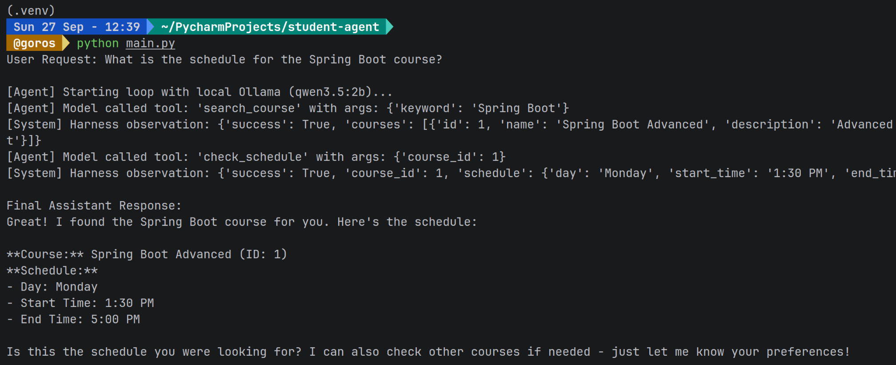

Student Assistant — Safe Agent Application
---

## 1. Project Overview

The **Student Assistant Agent** handles student inquiries regarding university course offerings. It accepts natural language queries, identifies necessary actions, calls appropriate tools, observes intermediate outputs, and synthesizes final responses. 

All tool invocations pass through an application-level safety harness (`harness.py`), ensuring that agent decisions remain strictly bounded by permission policies, input schemas, and execution limits.

---

## 2. Available Tools

The application exposes three tools defined in `tools.py` with schemas in `schemas.py`:

| Tool Name | Input Parameters | Description |
| :--- | :--- | :--- |
| `search_course` | `keyword` (str) | Searches the course catalog for courses matching a query in the title or description. |
| `check_schedule` | `course_id` (int, > 0) | Retrieves scheduled day, start time, and end time for a given course ID. |
| `register_course` | `course_id` (int, > 0), `user_id` (int, > 0) | Enrolls a user in a specific course. Restricted to administrator role. |

---

## 3. Agent Loop

The agent follows an iterative decision-making pattern:

```text
User Request
     ↓
LLM / Agent (Evaluates context & history)
     ↓
Tool Call Proposed (e.g., search_course)
     ↓
Safety Harness (Permission check + Pydantic validation)
     ↓
Tool Execution (tools.py logic)
     ↓
Observation Returned (Tool result appended to messages)
     ↓
Agent Decides Again (Calls another tool or generates final answer)
```
The loop runs until the agent produces a textual response or the maximum iteration threshold is reached.
## 4. Permission Rules
Permissions are enforced within application code in harness.py, not delegated to prompt instructions.

| Action / Tool | Student (role="student") | Admin (role="admin") |
| :--- | :--- | :--- |
| search_course | Authorized | Authorized | 
| check_schedule | Authorized | Authorized | 
|register_course | Denied | Authorized | 

If a student attempts to register for a course, the harness halts execution before reaching `tools.py` and returns a structured error:
```
{"success": false, "error": "Permission denied: Your role cannot execute 'register_course'."}.
```
The agent observes this failure and explains the restriction to the user.
## 5. Safety & Control Mechanisms
1. **Input Validation:** Tool arguments are validated against Pydantic models before execution. Fields such as course_id and user_id must satisfy positive integer constraints (gt=0), and search strings must satisfy min_length=1. Invalid inputs return a structured error without crashing the server.

2. **Controlled Error Handling:** Tool execution is wrapped in exception handlers. Internal runtime exceptions produce structured diagnostic dictionaries instead of unhandled stack traces, enabling the model to recover or report errors gracefully.

3. **Loop Limits:** A maximum iteration counter (max_iterations = 5) prevents recursive or runaway loops caused by model confusion or repetitive tool invocations.

## 6. Setup & Execution Instructions
Prerequisites
- Python 3.10+
- Ollama running locally with a tool-capable model (e.g., qwen2.5:3b or llama3.1)
### Installation
Clone the repository and enter the directory:
```Bash
git clone <your-repo-url>
cd my-agent
```
Install dependencies:
```Bash
pip install openai pydantic
```
Ensure Ollama is running and download the model:
```Bash
ollama pull qwen2.5:3b
````
Run the application:
```Bash
python main.py
```
## 7. Example Run
